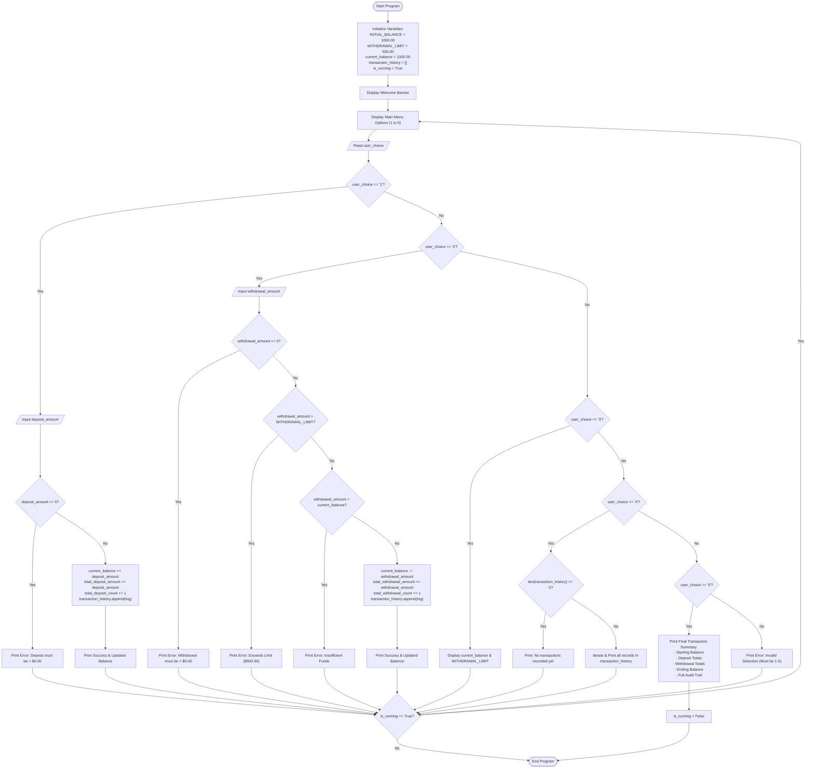

# Case Study 13: ATM Transaction Sequence Simulation
**Course:** Introduction to Python Programming (College Level)  
**Author / Student Reference:** Project Assignment Submission  
**Environment:** Standard Python 3 Interpreter (Top-Level Procedural Code)

---

## 1. Problem Statement

Automated Teller Machines (ATMs) are ubiquitous self-service banking terminals that allow account holders to perform essential financial transactions without direct assistance from human bank tellers. At the core of every ATM terminal is a reliable, secure software controller responsible for orchestrating real-time user interactions, maintaining financial ledger integrity, enforcing transaction boundaries, and generating detailed auditing records.

In this project, we address the challenge of simulating an ATM banking terminal for a single account. The software must facilitate repetitive transactions through a clear, menu-driven command-line interface. Specifically, the system must:
1. Initialize an account with a defined opening balance.
2. Provide continuous options to deposit funds, withdraw funds, check the current balance, view transaction logs, and exit the session.
3. Enforce strict defensive validation rules:
   - Prohibit negative or zero monetary inputs.
   - Enforce an upper ceiling on single-transaction withdrawals (to simulate cash dispenser limits and fraud-prevention controls).
   - Prevent overdrafts by rejecting withdrawal requests exceeding the available balance.
4. Maintain a chronological transaction history that records every successful monetary movement.
5. Generate an executive financial audit summary upon session termination, displaying initial balance, total deposits, total withdrawals, net change, final balance, and an itemized audit trail.

This simulation models the core logic of banking systems while reinforcing structured, sequential, and iterative programming principles.

---

## 2. Objectives

The primary pedagogical and technical objectives of this project are:
- **Implement Menu-Driven Iterative Control:** Construct a reliable, user-friendly loop using a `while` statement that continuously presents options until the user chooses to terminate the session.
- **Enforce Business and Safety Rules:** Apply nested and multi-way conditional branching (`if`, `elif`, `else`) to validate user inputs against business constraints (non-positive amounts, withdrawal limits, and insufficient funds).
- **Manage In-Memory State Variables:** Track running balances, cumulative deposit and withdrawal amounts, transaction frequency counts, and session flags across multiple iterations.
- **Maintain Chronological History Using Lists:** Use Python lists (`list.append()`) to log sequence-tagged transaction events and traverse them using `for` loops.
- **Format Financial Output:** Present monetary quantities cleanly and consistently to two decimal places using Python string formatting techniques.
- **Strictly Observe Introductory Constraints:** Solve a multi-faceted software problem using only variables, operators, conditional branches, loops, strings, lists, and standard input/output—intentionally avoiding user-defined functions (`def`), classes (`class`), or external modules.

---

## 3. Assumptions

To ensure clarity, deterministic execution, and real-world banking plausibility, the following assumptions are established:

| Assumption Parameter | Assigned Value | Justification & Real-World Analogy |
| :--- | :--- | :--- |
| **Initial Account Balance** | `$1,000.00` | Represents a typical opening balance for a student or checking account. It is sufficiently large to allow multiple successful deposits and withdrawals while enabling realistic insufficient-balance testing. |
| **Per-Transaction Withdrawal Limit** | `$500.00` | Simulates standard ATM hardware dispenser limits and fraud-prevention policies. Any withdrawal request greater than this threshold is rejected, regardless of account balance. |
| **Currency and Formatting** | US Dollars (`$`), 2 decimal places (`.2f`) | Standard currency format for financial accounting. All balances and transaction amounts are displayed formatted to two decimal places. |
| **Transaction History Recording** | Formatted string entries stored in a single list (`list[str]`) | Adheres strictly to the introductory Python requirement (lists and strings only). Each successful transaction appends a descriptive string containing the transaction type, signed amount, and resulting balance. |
| **Rejected Transactions Policy** | Display error; do not alter balance; do not log to history | In banking systems, rejected attempts (e.g., overdraft, over-limit, negative amount) do not alter the ledger. To keep the audit log clean, only successful transactions are recorded in the history list. |
| **Input Type & Scope** | Standard numeric inputs entered via keyboard | Users enter valid numeric representations (e.g., `250`, `100.50`). Non-numeric input handling is governed by standard introductory numeric parsing conventions. |
| **Session Lifecycle** | Single-user, in-memory session | Data persistence lasts for the duration of the execution run. Exiting via Option 5 terminates the session and displays the final audit report. |

---

## 4. Algorithm

The procedural algorithm governs the execution flow from program initialization to termination:

1. **Start.**
2. **Initialize Configuration Constants:**
   - Set `INITIAL_BALANCE = 1000.00`.
   - Set `WITHDRAWAL_LIMIT = 500.00`.
3. **Initialize Tracking Variables:**
   - Set `current_balance = INITIAL_BALANCE`.
   - Set `total_deposit_amount = 0.00`.
   - Set `total_withdrawal_amount = 0.00`.
   - Set `total_deposit_count = 0`.
   - Set `total_withdrawal_count = 0`.
   - Initialize an empty list: `transaction_history = []`.
   - Set loop control flag: `is_running = True`.
4. **Display Welcome Banner:**
   - Print the bank name, initial balance, and per-transaction withdrawal limit.
5. **Begin Main Interactive Loop (`while is_running is True`):**
   - 5.1. Display the ATM Main Menu:
     - 1. Deposit Funds
     - 2. Withdraw Funds
     - 3. Check Account Balance
     - 4. View Transaction History
     - 5. Exit & Generate Final Summary
   - 5.2. Prompt user: `user_choice = input()`.
   - 5.3. **Branch 1: User enters `"1"` (Deposit):**
     - 5.3.1. Prompt user for `deposit_amount`.
     - 5.3.2. Check if `deposit_amount <= 0`:
       - If true, display error: *"Transaction Rejected: Deposit amount must be greater than $0.00."*
     - 5.3.3. Else (valid deposit):
       - `current_balance = current_balance + deposit_amount`.
       - `total_deposit_amount = total_deposit_amount + deposit_amount`.
       - `total_deposit_count = total_deposit_count + 1`.
       - Construct string `log_entry` with transaction type, amount, and updated balance.
       - Append `log_entry` to `transaction_history`.
       - Display confirmation message with deposited amount and updated balance.
   - 5.4. **Branch 2: User enters `"2"` (Withdrawal):**
     - 5.4.1. Prompt user for `withdrawal_amount`.
     - 5.4.2. Check if `withdrawal_amount <= 0`:
       - If true, display error: *"Transaction Rejected: Withdrawal amount must be greater than $0.00."*
     - 5.4.3. Else if `withdrawal_amount > WITHDRAWAL_LIMIT`:
       - Display error: *"Transaction Rejected: Exceeds maximum limit of $500.00 per transaction."*
     - 5.4.4. Else if `withdrawal_amount > current_balance`:
       - Display error: *"Transaction Rejected: Insufficient funds."*
       - Display current available balance and requested amount.
     - 5.4.5. Else (valid withdrawal):
       - `current_balance = current_balance - withdrawal_amount`.
       - `total_withdrawal_amount = total_withdrawal_amount + withdrawal_amount`.
       - `total_withdrawal_count = total_withdrawal_count + 1`.
       - Construct string `log_entry` with transaction type, amount, and updated balance.
       - Append `log_entry` to `transaction_history`.
       - Display confirmation message with withdrawn amount and updated balance.
   - 5.5. **Branch 3: User enters `"3"` (Check Balance):**
     - 5.5.1. Display current available balance formatted to two decimal places.
     - 5.5.2. Display the per-transaction withdrawal limit.
   - 5.6. **Branch 4: User enters `"4"` (View Transaction History):**
     - 5.6.1. Check if `len(transaction_history) == 0`:
       - If true, display: *"No transactions recorded in this session yet."*
     - 5.6.2. Else:
       - Print table header (`No. | Type | Details`).
       - Iterate through `transaction_history` using a `for` loop, printing index and record details.
       - Display total count of logged transactions.
   - 5.7. **Branch 5: User enters `"5"` (Exit & Summary):**
     - 5.7.1. Display final audit header.
     - 5.7.2. Display starting balance (`INITIAL_BALANCE`).
     - 5.7.3. Display total deposits count and cumulative deposit sum.
     - 5.7.4. Display total withdrawals count and cumulative withdrawal sum.
     - 5.7.5. Display net balance adjustment (`total_deposit_amount - total_withdrawal_amount`).
     - 5.7.6. Display final ending balance (`current_balance`).
     - 5.7.7. Display itemized audit trail:
       - If list is empty, state that no transactions were performed.
       - Else, print each numbered record in sequential order.
     - 5.7.8. Display parting greeting.
     - 5.7.9. Set `is_running = False` to break out of the loop.
   - 5.8. **Branch 6: Invalid Choice (`else`):**
     - 5.8.1. Display: *"Invalid Selection: '[choice]' is not a recognized option."*
     - 5.8.2. Remind user to choose an option between 1 and 5.
6. **End.**

---

## 5. Flowchart

### 5.1 Mermaid Flowchart



### 5.2 Text-Based / ASCII Flowchart

```text
       +-------------------------------------------------------+
       |                        START                          |
       +-------------------------------------------------------+
                                   |
                                   v
       +-------------------------------------------------------+
       | Set INITIAL_BALANCE = 1000.00, WITHDRAWAL_LIMIT = 500 |
       | Set current_balance = 1000.00, history = [], is_run=T |
       +-------------------------------------------------------+
                                   |
                                   v
+----->+-------------------------------------------------------+
|      | Display Menu Options (1-5) & Read user_choice         |
|      +-------------------------------------------------------+
|                                  |
|         +----------------+-------+--------+---------------+
|         |                |                |               |
|         v                v                v               v
|     [Choice 1]       [Choice 2]       [Choice 3]      [Choice 4]
|      DEPOSIT          WITHDRAW         BALANCE         HISTORY
|         |                |                |               |
|    amount <= 0?     amount <= 0?    Display current  history empty?
|    /         \      /         \     balance & limit   /         \
|  (Yes)      (No)  (Yes)       (No)        |         (Yes)      (No)
|   |          |      |          |          |           |          |
| Error    Balance+ Amount >   Amount >   Print       Print     Iterate
| Msg      Audit Log  Limit?   Balance?   Values      "Empty"  & Print
|   |          |     (Yes)      (Yes)       |           |          |
|   |          |      |          |          |           |          |
|   |          |    Error      Error        |           |          |
|   |          |      \          /          |           |          |
|   |          |      (No to Both)          |           |          |
|   |          |           |                |           |          |
|   |          |       Balance-             |           |          |
|   |          |       Audit Log            |           |          |
|   +----------+-----------+----------------+-----------+          |
|                          |                                       |
|                          v                                       |
|                     [Choice 5] ----------------> [Other/Invalid] |
|                     EXIT & SUMMARY                  Error Msg    |
|                          |                              |        |
|             Print Full Financial Summary                |        |
|             and Sequential Audit Trail                  |        |
|                          |                              |        |
|                  Set is_running = False                 |        |
|                          |                              |        |
|                          v                              |        |
|                     +---------+                         |        |
|                     |   END   |                         |        |
|                     +---------+                         |        |
|                                                         |        |
+---------------------------------------------------------+--------+
```

---

## 6. Pseudocode

```text
BEGIN ATM_SIMULATION

    // 1. System Initial State & Constants
    INITIAL_BALANCE <- 1000.00
    WITHDRAWAL_LIMIT <- 500.00

    current_balance <- INITIAL_BALANCE
    total_deposit_amount <- 0.00
    total_withdrawal_amount <- 0.00
    total_deposit_count <- 0
    total_withdrawal_count <- 0
    
    transaction_history <- EMPTY_LIST
    is_running <- TRUE

    // 2. Banner Output
    PRINT "=================================================="
    PRINT "     WELCOME TO THE CITIZENS STATE BANK ATM       "
    PRINT "=================================================="
    PRINT "Account Initialized with Balance : $" + FORMAT(current_balance, 2)
    PRINT "Per-Transaction Withdrawal Limit : $" + FORMAT(WITHDRAWAL_LIMIT, 2)
    PRINT "=================================================="

    // 3. Central Event Loop
    WHILE is_running IS TRUE DO
        PRINT "\n----------------- ATM MAIN MENU ------------------"
        PRINT "1. Deposit Funds"
        PRINT "2. Withdraw Funds"
        PRINT "3. Check Account Balance"
        PRINT "4. View Transaction History"
        PRINT "5. Exit & Generate Final Summary"
        PRINT "--------------------------------------------------"
        
        PROMPT "Enter your choice (1-5): " TO user_choice

        IF user_choice EQUALS "1" THEN
            PRINT "\n--- DEPOSIT FUNDS ---"
            PROMPT "Enter amount to deposit ($): " TO deposit_input
            deposit_amount <- CONVERT_TO_FLOAT(deposit_input)

            IF deposit_amount <= 0.00 THEN
                PRINT "Transaction Rejected: Deposit amount must be greater than $0.00."
            ELSE
                current_balance <- current_balance + deposit_amount
                total_deposit_amount <- total_deposit_amount + deposit_amount
                total_deposit_count <- total_deposit_count + 1

                log_entry <- "Deposit     | Amount: +$" + FORMAT(deposit_amount, 2) + " | Balance: $" + FORMAT(current_balance, 2)
                APPEND log_entry TO transaction_history

                PRINT "Transaction Successful: Deposited $" + FORMAT(deposit_amount, 2)
                PRINT "Updated Balance: $" + FORMAT(current_balance, 2)
            END IF

        ELSE IF user_choice EQUALS "2" THEN
            PRINT "\n--- WITHDRAW FUNDS ---"
            PROMPT "Enter amount to withdraw ($): " TO withdrawal_input
            withdrawal_amount <- CONVERT_TO_FLOAT(withdrawal_input)

            IF withdrawal_amount <= 0.00 THEN
                PRINT "Transaction Rejected: Withdrawal amount must be greater than $0.00."
            ELSE IF withdrawal_amount > WITHDRAWAL_LIMIT THEN
                PRINT "Transaction Rejected: Exceeds maximum limit of $" + FORMAT(WITHDRAWAL_LIMIT, 2) + " per transaction."
            ELSE IF withdrawal_amount > current_balance THEN
                PRINT "Transaction Rejected: Insufficient funds."
                PRINT "Available Balance: $" + FORMAT(current_balance, 2) + " | Requested: $" + FORMAT(withdrawal_amount, 2)
            ELSE
                current_balance <- current_balance - withdrawal_amount
                total_withdrawal_amount <- total_withdrawal_amount + withdrawal_amount
                total_withdrawal_count <- total_withdrawal_count + 1

                log_entry <- "Withdrawal  | Amount: -$" + FORMAT(withdrawal_amount, 2) + " | Balance: $" + FORMAT(current_balance, 2)
                APPEND log_entry TO transaction_history

                PRINT "Transaction Successful: Withdrew $" + FORMAT(withdrawal_amount, 2)
                PRINT "Updated Balance: $" + FORMAT(current_balance, 2)
            END IF

        ELSE IF user_choice EQUALS "3" THEN
            PRINT "\n--- ACCOUNT BALANCE INQUIRY ---"
            PRINT "Current Available Balance: $" + FORMAT(current_balance, 2)
            PRINT "Per-Transaction Withdrawal Limit: $" + FORMAT(WITHDRAWAL_LIMIT, 2)

        ELSE IF user_choice EQUALS "4" THEN
            PRINT "\n--- TRANSACTION HISTORY LOG ---"
            IF LENGTH(transaction_history) EQUALS 0 THEN
                PRINT "No transactions recorded in this session yet."
            ELSE
                PRINT "No. | Type        | Details"
                PRINT "--------------------------------------------------"
                item_number <- 1
                FOR EACH record IN transaction_history DO
                    PRINT STRING(item_number) + ".  | " + record
                    item_number <- item_number + 1
                END FOR
                PRINT "--------------------------------------------------"
                PRINT "Total Transactions Logged: " + STRING(LENGTH(transaction_history))
            END IF

        ELSE IF user_choice EQUALS "5" THEN
            PRINT "\n=================================================="
            PRINT "          FINAL ATM TRANSACTION SUMMARY           "
            PRINT "=================================================="
            PRINT "Initial Starting Balance  : $" + FORMAT(INITIAL_BALANCE, 2)
            PRINT "Total Successful Deposits : " + STRING(total_deposit_count) + " (Sum: $" + FORMAT(total_deposit_amount, 2) + ")"
            PRINT "Total Successful Withdraws: " + STRING(total_withdrawal_count) + " (Sum: $" + FORMAT(total_withdrawal_amount, 2) + ")"
            PRINT "Net Balance Adjustment    : $" + FORMAT(total_deposit_amount - total_withdrawal_amount, 2)
            PRINT "Final Ending Balance      : $" + FORMAT(current_balance, 2)
            PRINT "--------------------------------------------------"
            PRINT "AUDIT TRAIL:"
            IF LENGTH(transaction_history) EQUALS 0 THEN
                PRINT "No transactions executed during this session."
            ELSE
                audit_index <- 1
                FOR EACH record IN transaction_history DO
                    PRINT "  [" + STRING(audit_index) + "] " + record
                    audit_index <- audit_index + 1
                END FOR
            END IF
            PRINT "=================================================="
            PRINT "Thank you for banking with Citizens State Bank. Goodbye!"
            PRINT "=================================================="

            is_running <- FALSE

        ELSE
            PRINT "Invalid Selection: '" + user_choice + "' is not a recognized option."
            PRINT "Please enter a numeric option between 1 and 5."
        END IF

    END WHILE

END ATM_SIMULATION
```

---

## 7. Complete Python Source Code

```python
# ==============================================================================
# Project Title       : ATM Transaction Sequence Simulation
# Case Study Number   : 13
# Course              : Introduction to Python Programming
# Description         : A menu-driven ATM transaction simulation for a single
#                       bank account, demonstrating control structures, loops,
#                       lists, and basic I/O without functions or classes.
# ==============================================================================

# ------------------------------------------------------------------------------
# 1. INITIAL SYSTEM CONFIGURATION & STATE VARIABLES
# ------------------------------------------------------------------------------
INITIAL_BALANCE = 1000.00       # Starting account balance in dollars
WITHDRAWAL_LIMIT = 500.00      # Maximum allowed withdrawal per transaction

current_balance = INITIAL_BALANCE
total_deposit_amount = 0.00
total_withdrawal_amount = 0.00
total_deposit_count = 0
total_withdrawal_count = 0

# List to record transaction audit strings
transaction_history = []

is_running = True

# ------------------------------------------------------------------------------
# 2. MAIN APPLICATION LOOP (MENU-DRIVEN INTERACTION)
# ------------------------------------------------------------------------------
print("==================================================")
print("     WELCOME TO THE CITIZENS STATE BANK ATM       ")
print("==================================================")
print("Account Initialized with Balance : $" + "{:.2f}".format(current_balance))
print("Per-Transaction Withdrawal Limit : $" + "{:.2f}".format(WITHDRAWAL_LIMIT))
print("==================================================")

while is_running:
    print("\n----------------- ATM MAIN MENU ------------------")
    print("1. Deposit Funds")
    print("2. Withdraw Funds")
    print("3. Check Account Balance")
    print("4. View Transaction History")
    print("5. Exit & Generate Final Summary")
    print("--------------------------------------------------")
    
    user_choice = input("Enter your choice (1-5): ").strip()
    
    # --------------------------------------------------------------------------
    # OPTION 1: DEPOSIT FUNDS
    # --------------------------------------------------------------------------
    if user_choice == "1":
        print("\n--- DEPOSIT FUNDS ---")
        deposit_input = input("Enter amount to deposit ($): ")
        deposit_amount = float(deposit_input)
        
        # Validation: Amount must be strictly positive
        if deposit_amount <= 0:
            print("Transaction Rejected: Deposit amount must be greater than $0.00.")
        else:
            current_balance = current_balance + deposit_amount
            total_deposit_amount = total_deposit_amount + deposit_amount
            total_deposit_count = total_deposit_count + 1
            
            # Format and record the transaction log entry
            log_entry = "Deposit     | Amount: +$" + "{:.2f}".format(deposit_amount) + " | Balance: $" + "{:.2f}".format(current_balance)
            transaction_history.append(log_entry)
            
            print("Transaction Successful: Deposited $" + "{:.2f}".format(deposit_amount))
            print("Updated Balance: $" + "{:.2f}".format(current_balance))
            
    # --------------------------------------------------------------------------
    # OPTION 2: WITHDRAW FUNDS
    # --------------------------------------------------------------------------
    elif user_choice == "2":
        print("\n--- WITHDRAW FUNDS ---")
        withdrawal_input = input("Enter amount to withdraw ($): ")
        withdrawal_amount = float(withdrawal_input)
        
        # Validation 1: Amount must be strictly positive
        if withdrawal_amount <= 0:
            print("Transaction Rejected: Withdrawal amount must be greater than $0.00.")
        # Validation 2: Amount must not exceed the per-transaction limit
        elif withdrawal_amount > WITHDRAWAL_LIMIT:
            print("Transaction Rejected: Exceeds maximum limit of $" + "{:.2f}".format(WITHDRAWAL_LIMIT) + " per transaction.")
        # Validation 3: Amount must not exceed the available balance
        elif withdrawal_amount > current_balance:
            print("Transaction Rejected: Insufficient funds.")
            print("Available Balance: $" + "{:.2f}".format(current_balance) + " | Requested: $" + "{:.2f}".format(withdrawal_amount))
        else:
            current_balance = current_balance - withdrawal_amount
            total_withdrawal_amount = total_withdrawal_amount + withdrawal_amount
            total_withdrawal_count = total_withdrawal_count + 1
            
            # Format and record the transaction log entry
            log_entry = "Withdrawal  | Amount: -$" + "{:.2f}".format(withdrawal_amount) + " | Balance: $" + "{:.2f}".format(current_balance)
            transaction_history.append(log_entry)
            
            print("Transaction Successful: Withdrew $" + "{:.2f}".format(withdrawal_amount))
            print("Updated Balance: $" + "{:.2f}".format(current_balance))
            
    # --------------------------------------------------------------------------
    # OPTION 3: CHECK ACCOUNT BALANCE
    # --------------------------------------------------------------------------
    elif user_choice == "3":
        print("\n--- ACCOUNT BALANCE INQUIRY ---")
        print("Current Available Balance: $" + "{:.2f}".format(current_balance))
        print("Per-Transaction Withdrawal Limit: $" + "{:.2f}".format(WITHDRAWAL_LIMIT))
        
    # --------------------------------------------------------------------------
    # OPTION 4: VIEW TRANSACTION HISTORY
    # --------------------------------------------------------------------------
    elif user_choice == "4":
        print("\n--- TRANSACTION HISTORY LOG ---")
        if len(transaction_history) == 0:
            print("No transactions recorded in this session yet.")
        else:
            print("No. | Type        | Details")
            print("--------------------------------------------------")
            item_number = 1
            for record in transaction_history:
                print(str(item_number) + ".  | " + record)
                item_number = item_number + 1
            print("--------------------------------------------------")
            print("Total Transactions Logged: " + str(len(transaction_history)))
            
    # --------------------------------------------------------------------------
    # OPTION 5: EXIT & GENERATE FINAL TRANSACTION SUMMARY
    # --------------------------------------------------------------------------
    elif user_choice == "5":
        print("\n==================================================")
        print("          FINAL ATM TRANSACTION SUMMARY           ")
        print("==================================================")
        print("Initial Starting Balance  : $" + "{:.2f}".format(INITIAL_BALANCE))
        print("Total Successful Deposits : " + str(total_deposit_count) + " (Sum: $" + "{:.2f}".format(total_deposit_amount) + ")")
        print("Total Successful Withdraws: " + str(total_withdrawal_count) + " (Sum: $" + "{:.2f}".format(total_withdrawal_amount) + ")")
        print("Net Balance Adjustment    : $" + "{:.2f}".format(total_deposit_amount - total_withdrawal_amount))
        print("Final Ending Balance      : $" + "{:.2f}".format(current_balance))
        print("--------------------------------------------------")
        print("AUDIT TRAIL:")
        if len(transaction_history) == 0:
            print("No transactions executed during this session.")
        else:
            audit_index = 1
            for record in transaction_history:
                print("  [" + str(audit_index) + "] " + record)
                audit_index = audit_index + 1
        print("==================================================")
        print("Thank you for banking with Citizens State Bank. Goodbye!")
        print("==================================================")
        
        # Terminate the loop
        is_running = False
        
    # --------------------------------------------------------------------------
    # INVALID MENU CHOICE
    # --------------------------------------------------------------------------
    else:
        print("Invalid Selection: '" + user_choice + "' is not a recognized option.")
        print("Please enter a numeric option between 1 and 5.")
```

---

## 8. Test Cases

| Test ID | Test Scenario / Objective | Starting Balance | Input Sequence | Expected Condition Evaluated | Expected System Response & Output Message | Expected Ending Balance |
| :---: | :--- | :---: | :--- | :--- | :--- | :---: |
| **TC-01** | **Initial Balance Check** | `$1,000.00` | Choice: `3` | Read-only check | Displays `$1000.00` available balance and `$500.00` limit | `$1,000.00` |
| **TC-02** | **Initial History Check (Empty)** | `$1,000.00` | Choice: `4` | `len(history) == 0` | Displays *"No transactions recorded in this session yet."* | `$1,000.00` |
| **TC-03** | **Normal Valid Deposit** | `$1,000.00` | Choice: `1`<br/>Amount: `250.00` | `deposit > 0` | Confirms deposit of `$250.00`. Logs entry. New balance: `$1250.00`. | `$1,250.00` |
| **TC-04** | **Invalid Negative Deposit** | `$1,250.00` | Choice: `1`<br/>Amount: `-50.00` | `deposit <= 0` | *"Transaction Rejected: Deposit amount must be greater than $0.00."* No log added. | `$1,250.00` |
| **TC-05** | **Invalid Zero Deposit** | `$1,250.00` | Choice: `1`<br/>Amount: `0.00` | `deposit <= 0` | *"Transaction Rejected: Deposit amount must be greater than $0.00."* No log added. | `$1,250.00` |
| **TC-06** | **Normal Valid Withdrawal** | `$1,250.00` | Choice: `2`<br/>Amount: `300.00` | `0 < wd <= 500`<br/>`wd <= balance` | Confirms withdrawal of `$300.00`. Logs entry. New balance: `$950.00`. | `$950.00` |
| **TC-07** | **Withdrawal Over Limit** | `$950.00` | Choice: `2`<br/>Amount: `600.00` | `withdrawal > 500.00` | *"Transaction Rejected: Exceeds maximum limit of $500.00 per transaction."* | `$950.00` |
| **TC-08** | **Invalid Negative Withdrawal** | `$950.00` | Choice: `2`<br/>Amount: `-100.00` | `withdrawal <= 0` | *"Transaction Rejected: Withdrawal amount must be greater than $0.00."* | `$950.00` |
| **TC-09** | **Insufficient Balance Withdrawal** | `$150.00` | Choice: `2`<br/>Amount: `200.00` | `withdrawal > balance`<br/>(with balance at $150) | *"Transaction Rejected: Insufficient funds. Available Balance: $150.00 | Requested: $200.00"* | `$150.00` |
| **TC-10** | **Viewing Populated History** | Various | Choice: `4` | `len(history) > 0` | Displays formatted numbered list of all successful transactions. | Unchanged |
| **TC-11** | **Invalid Menu Choice** | Any | Choice: `9` | Not in `{"1","2","3","4","5"}` | *"Invalid Selection: '9' is not a recognized option. Please enter a numeric option between 1 and 5."* | Unchanged |
| **TC-12** | **Session Exit & Summary** | Any | Choice: `5` | Loop termination trigger | Displays full summary with initial balance, deposit/withdrawal counts/sums, net change, final balance, itemized audit, and farewell. Program halts. | Preserved |

---

## 9. Sample Program Output

```text
==================================================
     WELCOME TO THE CITIZENS STATE BANK ATM       
==================================================
Account Initialized with Balance : $1000.00
Per-Transaction Withdrawal Limit : $500.00
==================================================

----------------- ATM MAIN MENU ------------------
1. Deposit Funds
2. Withdraw Funds
3. Check Account Balance
4. View Transaction History
5. Exit & Generate Final Summary
--------------------------------------------------
Enter your choice (1-5): 3

--- ACCOUNT BALANCE INQUIRY ---
Current Available Balance: $1000.00
Per-Transaction Withdrawal Limit: $500.00

----------------- ATM MAIN MENU ------------------
1. Deposit Funds
2. Withdraw Funds
3. Check Account Balance
4. View Transaction History
5. Exit & Generate Final Summary
--------------------------------------------------
Enter your choice (1-5): 4

--- TRANSACTION HISTORY LOG ---
No transactions recorded in this session yet.

----------------- ATM MAIN MENU ------------------
1. Deposit Funds
2. Withdraw Funds
3. Check Account Balance
4. View Transaction History
5. Exit & Generate Final Summary
--------------------------------------------------
Enter your choice (1-5): 1

--- DEPOSIT FUNDS ---
Enter amount to deposit ($): 500.00
Transaction Successful: Deposited $500.00
Updated Balance: $1500.00

----------------- ATM MAIN MENU ------------------
1. Deposit Funds
2. Withdraw Funds
3. Check Account Balance
4. View Transaction History
5. Exit & Generate Final Summary
--------------------------------------------------
Enter your choice (1-5): 1

--- DEPOSIT FUNDS ---
Enter amount to deposit ($): -75.00
Transaction Rejected: Deposit amount must be greater than $0.00.

----------------- ATM MAIN MENU ------------------
1. Deposit Funds
2. Withdraw Funds
3. Check Account Balance
4. View Transaction History
5. Exit & Generate Final Summary
--------------------------------------------------
Enter your choice (1-5): 2

--- WITHDRAW FUNDS ---
Enter amount to withdraw ($): 350.00
Transaction Successful: Withdrew $350.00
Updated Balance: $1150.00

----------------- ATM MAIN MENU ------------------
1. Deposit Funds
2. Withdraw Funds
3. Check Account Balance
4. View Transaction History
5. Exit & Generate Final Summary
--------------------------------------------------
Enter your choice (1-5): 2

--- WITHDRAW FUNDS ---
Enter amount to withdraw ($): 650.00
Transaction Rejected: Exceeds maximum limit of $500.00 per transaction.

----------------- ATM MAIN MENU ------------------
1. Deposit Funds
2. Withdraw Funds
3. Check Account Balance
4. View Transaction History
5. Exit & Generate Final Summary
--------------------------------------------------
Enter your choice (1-5): 2

--- WITHDRAW FUNDS ---
Enter amount to withdraw ($): 0.00
Transaction Rejected: Withdrawal amount must be greater than $0.00.

----------------- ATM MAIN MENU ------------------
1. Deposit Funds
2. Withdraw Funds
3. Check Account Balance
4. View Transaction History
5. Exit & Generate Final Summary
--------------------------------------------------
Enter your choice (1-5): 1

--- DEPOSIT FUNDS ---
Enter amount to deposit ($): 200.00
Transaction Successful: Deposited $200.00
Updated Balance: $1350.00

----------------- ATM MAIN MENU ------------------
1. Deposit Funds
2. Withdraw Funds
3. Check Account Balance
4. View Transaction History
5. Exit & Generate Final Summary
--------------------------------------------------
Enter your choice (1-5): 2

--- WITHDRAW FUNDS ---
Enter amount to withdraw ($): 400.00
Transaction Successful: Withdrew $400.00
Updated Balance: $950.00

----------------- ATM MAIN MENU ------------------
1. Deposit Funds
2. Withdraw Funds
3. Check Account Balance
4. View Transaction History
5. Exit & Generate Final Summary
--------------------------------------------------
Enter your choice (1-5): 8
Invalid Selection: '8' is not a recognized option.
Please enter a numeric option between 1 and 5.

----------------- ATM MAIN MENU ------------------
1. Deposit Funds
2. Withdraw Funds
3. Check Account Balance
4. View Transaction History
5. Exit & Generate Final Summary
--------------------------------------------------
Enter your choice (1-5): 4

--- TRANSACTION HISTORY LOG ---
No. | Type        | Details
--------------------------------------------------
1.  | Deposit     | Amount: +$500.00 | Balance: $1500.00
2.  | Withdrawal  | Amount: -$350.00 | Balance: $1150.00
3.  | Deposit     | Amount: +$200.00 | Balance: $1350.00
4.  | Withdrawal  | Amount: -$400.00 | Balance: $950.00
--------------------------------------------------
Total Transactions Logged: 4

----------------- ATM MAIN MENU ------------------
1. Deposit Funds
2. Withdraw Funds
3. Check Account Balance
4. View Transaction History
5. Exit & Generate Final Summary
--------------------------------------------------
Enter your choice (1-5): 5

==================================================
          FINAL ATM TRANSACTION SUMMARY           
==================================================
Initial Starting Balance  : $1000.00
Total Successful Deposits : 2 (Sum: $700.00)
Total Successful Withdraws: 2 (Sum: $750.00)
Net Balance Adjustment    : -$50.00
Final Ending Balance      : $950.00
--------------------------------------------------
AUDIT TRAIL:
  [1] Deposit     | Amount: +$500.00 | Balance: $1500.00
  [2] Withdrawal  | Amount: -$350.00 | Balance: $1150.00
  [3] Deposit     | Amount: +$200.00 | Balance: $1350.00
  [4] Withdrawal  | Amount: -$400.00 | Balance: $950.00
==================================================
Thank you for banking with Citizens State Bank. Goodbye!
==================================================
```

---

## 10. Conclusion

The **ATM Transaction Sequence Simulation** successfully illustrates how fundamental programming constructs can be synthesized to construct a robust, interactive financial console application. 

### Key Accomplishments & Concepts Mastered:
1. **Procedural Control Flow:** By leveraging an event-driven `while` loop coupled with multi-way `if-elif-else` branches, the program handles varied, non-linear user decision sequences while maintaining deterministic internal state.
2. **Defensive Input Validation:** Financial ledger integrity was safeguarded by rejecting invalid inputs (non-positive amounts, single-transaction ceiling breaches, and overdraft attempts) before any calculation or state mutation took place.
3. **Dynamic In-Memory Auditing:** Utilizing Python's native `list` structure allowed dynamic tracking of chronological transactions, demonstrating how sequential data collections can be populated with `append()` and later iterated over with `for` loops.
4. **Clean Presentation:** Monetary values were consistently aligned and formatted using two-decimal string formatting (`{:.2f}`), mirroring commercial banking output.

### Constraints & Future Roadmap:
While the project adhered strictly to introductory constraints (avoiding functions, classes, and external libraries), professional banking software naturally expands upon these foundations:
- **Modularization:** Refactoring repetitive logic into parameterized functions (`deposit()`, `withdraw()`, `print_menu()`) would reduce code duplication and enhance unit-testability.
- **Object-Oriented Architecture:** Encapsulating account state, customer identity, and transaction methods into a `BankAccount` class would enable multi-account support.
- **Persistent Storage:** Integrating file I/O (CSV, JSON) or relational databases (SQLite) would ensure balances and transaction histories survive program restarts.
- **Authentication & Security:** Incorporating PIN verification, multi-factor authentication, and encryption would elevate the prototype toward enterprise-grade security.

In conclusion, this project provides a solid, accessible foundation in algorithmic thinking, data validation, and state management essential for future coursework in computer science and software development.
